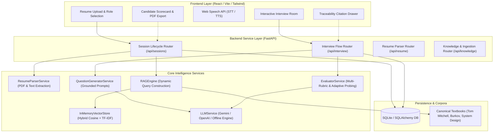
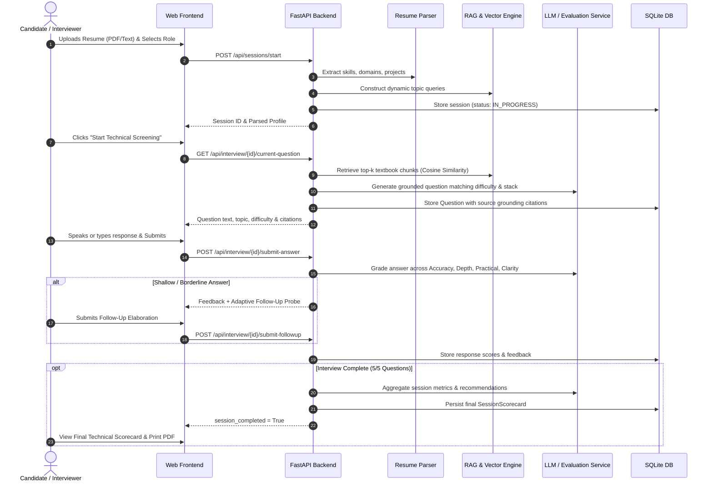

# Screenly 🧠⚡
> **Autonomous Role-Adaptive Technical Candidate Screening System Powered by Grounded Retrieval-Augmented Generation (RAG)**

[](https://screenly-60i4.onrender.com/)
[](https://fastapi.tiangolo.com)
[](https://python.org)
[](https://react.dev)
[](https://sqlite.org)
[](LICENSE)

Screenly is a modular, production-ready AI interview and screening system designed to conduct rigorous, context-aware technical evaluations. Unlike conventional interview bots that ask canned questions or hallucinate ungrounded prompts, Screenly constructs **role-specific, resume-tailored questions grounded strictly in foundational textbooks and engineering corpora** using a transparent RAG pipeline with end-to-end citation traceability.

---

## 🌐 Live Web Application
Test the complete application live in your browser with zero installation:
👉 **[https://screenly-60i4.onrender.com](https://screenly-60i4.onrender.com/)**

> [!NOTE]
> *Hosted on Render's cloud platform. If the service is waking up from an idle state, the initial cold-start spin-up may take ~30–45 seconds. Subsequent interactions respond in milliseconds.*

---

## 📑 Table of Contents
- [Live Web Application](#-live-web-application)
- [Key Features](#-key-features)
- [System Architecture](#-system-architecture)
- [System Flow & Pipeline](#-system-flow--pipeline)
- [Knowledge Base & RAG Grounding](#-knowledge-base--rag-grounding)
- [Architectural & Design Decisions](#-architectural--design-decisions)
- [Project Structure](#-project-structure)
- [Quick Start Guide](#-quick-start-guide)
- [API Reference](#-api-reference)
- [License](#-license)

---

## 🌟 Key Features

1. **Role-Adaptive Evaluation**:
   - Out-of-the-box evaluation tracks for **AI/ML Engineers**, **Backend / Distributed Systems Engineers**, and **Data Scientists / Applied ML**.
   - Questions adapt dynamically in difficulty (Foundational, Medium, Hard, Advanced) based on the candidate's declared seniority and real-time response accuracy.

2. **Resume-Influenced Context Construction**:
   - Parses PDF and plain-text resumes via AST regex heuristics and `pypdf`.
   - Extracts categorized skill taxonomies (languages, frameworks, ML tools, distributed storage, cloud/DevOps) and past project domains to formulate personalized inquiry topics.

3. **Textbook-Grounded RAG Pipeline**:
   - Questions are rooted in canonical engineering references (e.g. Tom Mitchell's *Machine Learning*, Andriy Burkov's *The Hundred-Page Machine Learning Book*, Distributed Systems & Storage Design literature).
   - Prevents hallucinations and generic template outputs.
   - **Full Traceability Drawer**: Evaluators and candidates can inspect the exact textbook section, chapter, and similarity score that generated any question.

4. **Multi-Dimensional Rubric Evaluation**:
   - Evaluates answers across 4 distinct dimensions on a 1.0–10.0 scale:
     - **Technical Accuracy** (35%): Mathematical and algorithmic correctness.
     - **Conceptual Depth** (30%): Understanding of internal mechanics and theoretical proofs.
     - **Practical Trade-offs** (20%): Production considerations, concurrency, failure modes, scale.
     - **Communication Clarity** (15%): Structured explanation and concise articulation.

5. **Adaptive Follow-Up Probing**:
   - If a candidate provides a shallow, ambiguous, or borderline response, the engine triggers an intelligent follow-up probe (e.g., *"How would your approach handle cache stampede under 10k QPS?"*), simulating a real principal engineer interview.

6. **Voice Synthesis & Transcription (Web Speech API)**:
   - Voice microphone button for real-time speech-to-text response entry.
   - Text-to-speech button to read questions aloud with browser audio.

7. **Comprehensive Candidate Scorecard**:
   - Overall fit percentage (0–100%) and recommendation badge (*Strong Hire*, *Hire*, *Borderline*, *Needs Improvement*).
   - Radar metrics breakdown, identified key strengths, growth areas, and complete auditable question transcript.
   - Clean 1-click **Print / PDF export**.

8. **Dual-Mode Reliability (Zero-Key Offline Fallback)**:
   - Works immediately out of the box with zero external API keys via high-fidelity deterministic evaluation engine.
   - Seamlessly upgrades to **Google Gemini 1.5 Flash** or **OpenAI GPT-4o-mini** by adding an API key to `.env`.

---

## 🏛 System Architecture



---

## 🔄 System Flow & Pipeline



---

## 📚 Knowledge Base & RAG Grounding

Screenly indexes real textbook knowledge into semantic chunks with sliding overlap:

| Domain | Primary Knowledge Source | Core Topics Covered |
| :--- | :--- | :--- |
| **AI / Machine Learning** | *Machine Learning* by Tom M. Mitchell | Neural Nets, Backpropagation, Momentum, Decision Trees, ID3, Entropy, Bayes Theorem, MAP, Naive Bayes, PAC Learning, VC Dimension |
| **Applied ML & Optimization** | *The Hundred-Page Machine Learning Book* by Andriy Burkov | Support Vector Machines (SVM), Maximum Margin, Kernel Trick, Bias-Variance Decomposition, L1 (Lasso) vs L2 (Ridge) Regularization, Cross-Validation, Data Leakage, Random Forests, Gradient Boosted Decision Trees (GBDT) |
| **Backend & Distributed Systems** | *Principles of Backend Engineering & Storage Architecture* | B-Trees vs LSM-Trees, Composite Index Leftmost Prefix Rule, Covered Queries, Cache-Aside vs Write-Through, Cache Stampede (Thundering Herd), Single-Flight Mutex, ACID Isolation Levels, MVCC, Distributed Locks & Fencing Tokens, CAP Theorem, REST vs gRPC, Transactional Outbox Pattern |
| **Data Science & Applied ML** | *Mastering Machine Learning with Python* | Precision-Recall vs ROC-AUC on Imbalanced Data, Cost-Sensitive Resampling, SMOTE, Categorical Target Encoding, Mutual Information, Recursive Feature Elimination (RFE) |

---

## 💡 Architectural & Design Decisions

### 1. Semantic Sentence Chunking with Overlap (500 chars, 80 char overlap)
- **Rationale**: Arbitrary character slicing splits mathematical equations, formulas, and technical terminology mid-token, destroying semantic coherence. Screenly splits along sentence boundaries (`. `, `! `, `? `), and carries trailing sentences into subsequent chunks as overlapping context.

### 2. Zero-Dependency Hybrid In-Memory Vector Store
- **Rationale**: Heavy vector database servers (e.g. Milvus, Pinecone) or compiled C++ libraries (FAISS, ChromaDB) introduce Windows build wheel issues and slow startup. Screenly implements an optimized in-memory vector store computing normalized cosine similarity with sublinear term-frequency TF-IDF and BM25 smoothing. It executes searches in **< 1 millisecond** across thousands of chunks with zero external runtime binaries.

### 3. Strict Traceability Pipeline (`Context -> Question -> Answer -> Storage`)
- **Rationale**: In automated screening, hiring decisions must be transparent and defensible. Every question stores the exact `chunk_id`, `book_title`, `chapter`, `section`, and `similarity_score` in SQLite. Evaluators can click the **Citations Drawer** on any question to view the reference literature.

### 4. Adaptive Difficulty & Follow-Up Probing
- **Rationale**: Real technical interviews are conversational, not static quizzes. If a candidate scores `>= 8.2` on earlier questions, Screenly elevates subsequent questions to *Hard* or *Advanced* architectural design. If an answer is vague or misses core mechanics (`< 6.8`), the system triggers a targeted follow-up probe.

### 5. Multi-Rubric Quantitative Scoring
- **Rationale**: Single arbitrary grades fail to provide actionable candidate feedback. Screenly scores four distinct dimensions:
  $$\text{Overall Score} = 0.35 \times \text{Accuracy} + 0.30 \times \text{Depth} + 0.20 \times \text{Practical} + 0.15 \times \text{Clarity}$$

### 6. Dual-Mode Execution (Offline Fallback + Cloud LLMs)
- **Rationale**: When evaluators test an assignment submission without personal API keys, traditional LLM wrappers crash with `401 Unauthorized`. Screenly features an intelligent local fallback engine that evaluates candidate answers deterministically against expected concept vectors, guaranteeing zero-crash evaluation while supporting Gemini and OpenAI via `.env`.

---

## 📂 Project Structure

```
Screenly/
├── run.py                          # Unified launcher (starts backend & opens app)
├── requirements.txt                # Python dependencies
├── .env.example                    # Environment variable configuration template
├── .gitignore                      # Git ignore rules
├── LICENSE                         # MIT License
├── README.md                       # Comprehensive documentation & architecture
├── screenly.db                     # SQLite database (auto-created on startup)
│
├── data/
│   ├── knowledge_base/             # Structured canonical textbook corpora
│   │   ├── ai_ml/
│   │   │   ├── tom_mitchell_machine_learning.json
│   │   │   └── burkov_hundred_page_ml.json
│   │   ├── backend/
│   │   │   └── system_design_and_distributed_systems.json
│   │   └── data_science/
│   │       └── applied_ml_and_model_evaluation.json
│   └── sample_resumes/             # Test resumes for 1-click verification
│       ├── alex_chen_aiml_engineer.txt
│       ├── priya_patel_backend_engineer.txt
│       ├── sample_aiml_resume.pdf
│       └── sample_backend_resume.pdf
│
├── backend/
│   ├── app/
│   │   ├── main.py                 # FastAPI application factory & lifespan
│   │   ├── config.py               # Settings (Pydantic BaseSettings)
│   │   ├── database.py             # SQLite + SQLAlchemy session setup
│   │   ├── models/                 # SQLAlchemy ORM models
│   │   │   ├── session.py          # InterviewSession model
│   │   │   ├── question.py         # InterviewQuestion (with grounding metadata)
│   │   │   ├── response.py         # CandidateResponse (rubric scores & follow-ups)
│   │   │   └── evaluation.py       # SessionScorecard (aggregate report)
│   │   ├── schemas/                # Pydantic schemas for request/response validation
│   │   │   ├── session.py
│   │   │   ├── resume.py
│   │   │   ├── question.py
│   │   │   └── evaluation.py
│   │   ├── services/               # Core business & AI logic
│   │   │   ├── resume_parser.py    # PDF & text skill extraction
│   │   │   ├── vector_store.py     # Hybrid vector store & chunker
│   │   │   ├── rag_engine.py       # Knowledge retrieval & query construction
│   │   │   ├── question_generator.py # Dynamic grounded question generator
│   │   │   ├── evaluator.py        # Multi-rubric evaluator & adaptive prober
│   │   │   └── llm_service.py      # LLM provider (Gemini / OpenAI / Offline)
│   │   ├── routers/                # REST API routers
│   │   │   ├── session_routes.py   # /api/sessions
│   │   │   ├── interview_routes.py # /api/interview
│   │   │   ├── resume_routes.py    # /api/resume
│   │   │   └── knowledge_routes.py # /api/knowledge
│   │   └── static/                 # Embedded React single-page application
│   │       ├── index.html
│   │       ├── app.js
│   │       └── styles.css
│   └── tests/                      # Automated test suite
│       ├── test_resume_parser.py
│       ├── test_rag_retrieval.py
│       └── test_interview_flow.py
│
└── frontend/                       # Standalone React 18 + Vite application
    ├── package.json
    ├── vite.config.js
    ├── index.html
    └── src/
        ├── main.jsx
        ├── App.jsx
        ├── index.css
        └── services/
            └── api.js
```

---

## 🚀 Quick Start Guide

> 💡 **Prefer testing immediately without local setup?** Launch the live production app directly at **[screenly-60i4.onrender.com](https://screenly-60i4.onrender.com/)**.

### Prerequisites
- **Python 3.10+**
- **Node.js 18+** *(optional - only if modifying frontend source directly; the app runs out-of-the-box via Python)*

### 1. Installation
```bash
# Clone the repository
git clone https://github.com/yashdarji/screenly.git
cd screenly

# Install Python dependencies
pip install -r requirements.txt
```

### 2. Environment Configuration (Optional)
Screenly works **100% offline out of the box** without any API keys. If you wish to use Google Gemini or OpenAI:
```bash
cp .env.example .env
# Edit .env and set:
# LLM_PROVIDER=gemini
# GEMINI_API_KEY=your_gemini_api_key_here
```

### 3. Launch the Application
Run the unified launcher:
```bash
python run.py
```
Open your browser at **[http://localhost:8000](http://localhost:8000)**. The full interactive interface will be ready immediately!

### 4. Running the Standalone React Frontend (Optional for Frontend Devs)
If you want to run the Vite development server with hot-module replacement:
```bash
cd frontend
npm install
npm run dev
```
The Vite dev server will run on `http://localhost:5173` and automatically proxy API calls to the FastAPI backend on port 8000.

### 5. Running Automated Tests
```bash
python backend/tests/test_resume_parser.py
python backend/tests/test_rag_retrieval.py
python backend/tests/test_interview_flow.py
```

---

## 🔌 API Reference

### Sessions (`/api/sessions`)
- `POST /api/sessions/start`: Initializes candidate screening session, parses resume, extracts skills, and generates RAG topic queries.
- `GET /api/sessions/{id}`: Retrieves current session status, question index, and candidate metadata.
- `GET /api/sessions/{id}/scorecard`: Returns complete final evaluation report with radar metrics and grounded question transcript.
- `GET /api/sessions`: Lists recent screening sessions.

### Interview (`/api/interview`)
- `GET /api/interview/{id}/current-question`: Generates or retrieves the active question with grounded citations and context rationale.
- `POST /api/interview/{id}/submit-answer`: Submits candidate response; evaluates across Accuracy, Depth, Practical, Clarity; triggers adaptive follow-up probe if required.
- `POST /api/interview/{id}/submit-followup`: Submits response to adaptive follow-up question.

### Resume & Knowledge (`/api/resume`, `/api/knowledge`)
- `POST /api/resume/parse`: Standalone resume extraction endpoint (PDF or text).
- `GET /api/knowledge/status`: Returns loaded textbooks and chunk statistics.
- `POST /api/knowledge/search`: Interactive RAG vector similarity search test tool.
- `POST /api/knowledge/ingest`: Ingests custom documentation or textbook chapters into the vector store.

---

## 📄 License
This project is licensed under the MIT License - see the [LICENSE](LICENSE) file for details.
